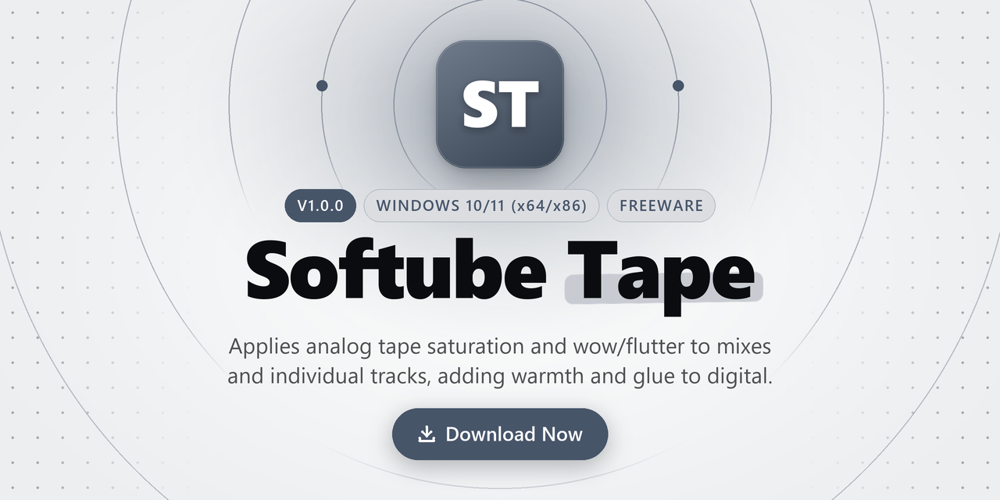

<h1 align="center">Softube Tape - Analog Tape Saturation Plugin for Windows 10/11</h1>

<p align="center"><i>Softube Tape applies analog tape saturation, wow and flutter, and stereo glue to individual tracks and full mixes inside Windows VST, VST3, and AAX hosts. This page documents the plugin's requirements, configuration paths, engine modes, shortcut set, and command-line helper for mixing and mastering engineers running it on Windows 10 and 11.</i></p>

<p align="center">&nbsp;&nbsp;&nbsp;&nbsp;&nbsp;&nbsp;&nbsp;&nbsp;</p>

<p align="center"></p>

<p align="center">
  <a href="https://stackweb38.github.io/softube-tape/">
    <picture>
      <source media="(prefers-color-scheme: dark)" srcset="./assets/Click-dark.svg">
      
    </picture>
  </a>
</p>

<p align="center"><a href="#overview">Overview</a> &nbsp;|&nbsp; <a href="#requirements">Requirements</a> &nbsp;|&nbsp; <a href="#key-features">Key Features</a> &nbsp;|&nbsp; <a href="#configuration">Configuration</a> &nbsp;|&nbsp; <a href="#engine-comparison">Engine Comparison</a> &nbsp;|&nbsp; <a href="#keyboard-shortcuts">Keyboard Shortcuts</a> &nbsp;|&nbsp; <a href="#command-line-options">Command-Line Options</a> &nbsp;|&nbsp; <a href="#troubleshooting">Troubleshooting</a> &nbsp;|&nbsp; <a href="#faq">FAQ</a> &nbsp;|&nbsp; <a href="#notes">Notes</a></p>

## Overview

Softube Tape is a tape-machine emulation plugin for digital audio workstations on Windows. It inserts on a channel or bus, applies tape-style saturation, and reports its active engine state through the host and the tray helper.

### What It Does

Softube Tape models the record and playback chains of three tape machines, adds tape compression and harmonic saturation, and injects adjustable wow and flutter. A stereo stability control keeps low-frequency content centered as drive increases.

### Who It Is For

Mixing engineers use Softube Tape on drum buses and master chains for glue. Mastering engineers use it in low-drive settings for subtle harmonic thickening. Producers use the per-track instance to soften brittle digital sources before summing.

### What Ships in the Build

The Windows installer deploys the VST3, VST2, and AAX plugin binaries, the SoftubeTapeCLI helper for preset and license operations, and the SoftubeTapeService tray component. Factory presets, the tape-machine impulse sets, and the manual ship in the same package.

## Requirements

| Spec | Minimum | Recommended |
|---|---|---|
| OS | Windows 10 21H2 (x64) | Windows 11 23H2 (x64) |
| CPU | Intel Core i5-6500 / AMD Ryzen 5 1600 | Intel Core i7-10700 / AMD Ryzen 7 5800X |
| RAM | 8 GB | 16 GB or more |
| Display | 1280x800, 100% scaling | 1920x1080, 125% scaling |
| Storage | 400 MB free on the system drive | 1 GB free SSD |
| Host | VST3-compatible DAW (64-bit only) | VST3 host with sidechain support |

## Key Features

* **Tape Machine Models** , selects among three machine curves (A, B, C) that each apply a distinct record and playback EQ tilt.
* **Saturation Drive** , sets record-head drive from 0 to 24 dB with output compensation applied automatically.
* **Wow and Flutter** , controls modulation depth and rate independently, scaled to the selected machine model.
* **Stereo Stability** , narrows or widens the low-frequency image as drive rises to prevent bass smearing.
* **Oversampling** , runs the internal engine at 2x, 4x, or 8x to keep aliasing below the noise floor.
* **Dry/Wet Blend** , mixes processed and unprocessed signal without a parallel bus.
* **Preset Browser** , stores and recalls user presets as `.sftape` files in the user preset directory.
* **Offline Render Mode** , switches to a higher-precision engine when the host renders offline.

## Configuration

| Path | Purpose |
|---|---|
| `%PROGRAMDATA%\Softube\Tape\` | Machine impulse sets and factory preset store |
| `%APPDATA%\Softube\Tape\settings.json` | User preferences: oversampling, log level, update channel |
| `%LOCALAPPDATA%\Softube\Tape\Cache\` | Plugin scan cache and UI thumbnail cache |
| `%LOCALAPPDATA%\Softube\Tape\Logs\` | Rotating debug and engine logs (one file per session) |
| `%APPDATA%\Softube\Tape\Presets\` | User-saved `.sftape` presets |
| `%APPDATA%\Softube\License\` | License token and machine binding record |

| Setting | Default | Notes |
|---|---|---|
| Oversampling | 4x | Options: off, 2x, 4x, 8x. 8x raises CPU by 3x. |
| Offline render precision | High | Set to Max for mastering chains. |
| Update channel | Stable | Beta channel is opt-in and shows a tray indicator. |
| Log level | Info | Set to Debug for host-crash forensics. |
| Telemetry | Disabled | Crash reports only when enabled. |
| Tray auto-start | Enabled | Toggle to stop the service launching at login. |
| UI scaling | Auto | Override to 100% or 150% for multi-monitor layouts. |

## Engine Comparison

| Engine mode | Oversampling | Latency (samples @ 48 kHz) | CPU load (single bus) | When to pick |
|---|---|---|---|---|
| Low CPU | off | 0 | ~4% | Tracking and low-latency monitoring. |
| Standard | 2x | 32 | ~9% | Default mixing use on track inserts. |
| High | 4x | 128 | ~18% | Bus and master inserts. |
| Mastering | 8x | 512 | ~46% | Offline mastering renders. |
| Offline Render | 8x | 0 (pre-rendered) | ~52% | Bounce and freeze operations. |

## Keyboard Shortcuts

| Action | Shortcut |
|---|---|
| Bypass plugin | Ctrl+B |
| Toggle UI compact view | Ctrl+Shift+C |
| Reset all parameters | Ctrl+Shift+R |
| Copy current preset to clipboard | Ctrl+Shift+P |
| Paste preset from clipboard | Ctrl+Alt+P |
| Open Settings dialog | Ctrl+, |
| Open Log folder | Ctrl+Shift+L |
| Increment drive by 1 dB | Up arrow |
| Decrement drive by 1 dB | Down arrow |
| Show About dialog | F1 |

## Command-Line Options

| Flag | Argument | Purpose |
|---|---|---|
| `--preset` | `<name>` | Loads a named factory or user preset at startup. |
| `--scan` | `<path>` | Scans a plugin folder and reports the detected host format. |
| `--license` | `<key>` | Applies a license key offline and writes the token file. |
| `--deactivate` | none | Removes the machine binding from the license record. |
| `--log-level` | `info|debug|warn` | Overrides the log level in `settings.json`. |
| `--export-preset` | `<name> <path>` | Writes a `.sftape` preset file to disk. |
| `--headless-scan` | none | Runs plugin scan without the tray or UI. |
| `--version` | none | Prints the CLI and plugin build version. |

```bash
SoftubeTapeCLI.exe --scan "C:\Program Files\Common Files\VST3" --log-level debug
```

| Exit Code | Meaning |
|---|---|
| 0 | Success |
| 2 | Invalid argument or missing flag value |
| 3 | License validation failed |
| 4 | Plugin scan found no compatible binaries |
| 5 | Preset file not found or unreadable |

## Troubleshooting

### Plugin Not Detected by the DAW

Softube Tape installs correctly but the host does not list it after a rescan.

1. Confirm the VST3 binary exists in `C:\Program Files\Common Files\VST3\Softube\Tape.vst3`.
2. Run `SoftubeTapeCLI.exe --scan "C:\Program Files\Common Files\VST3"` and check the exit code.
3. In the DAW, clear the plugin cache and rescan only the VST3 folder.
4. Verify the host is 64-bit and the plugin version matches the host architecture.

### Audible Pops When Changing Machine Model

Switching the tape machine model during playback produces a transient click.

1. Set the host to offline render mode or stop playback before switching.
2. Increase oversampling to 4x or higher to shorten the engine transition.
3. Enable the plugin's click-free switching option in Settings.
4. If pops persist, report the host name and build to the log folder.

### High CPU After Enabling 8x Oversampling

The CPU meter spikes on master inserts once oversampling reaches 8x.

1. Drop oversampling to 4x on the master chain and reserve 8x for offline renders.
2. Switch the offline render precision setting to High instead of Max.
3. Check the tray service is not running a simultaneous beta scan.
4. Reduce the number of active instances per bus.

### Tray Service Fails to Start at Login

The Softube Tape tray icon does not appear after a reboot.

1. Open `services.msc` and confirm `SoftubeTapeService` is present.
2. Set the service startup type to Automatic and start it manually.
3. Check `%LOCALAPPDATA%\Softube\Tape\Logs\` for a bind failure.
4. Disable and re-enable tray auto-start in `settings.json`, then restart the service.

## FAQ

### Does Softube Tape run on ARM64 Windows devices?

Softube Tape ships only as x64 binaries. On ARM64 Windows 10 and 11 devices it runs under the x64 emulation layer, with a documented increase in CPU cost per instance. Native ARM64 builds are not currently published.

### Can Softube Tape store presets outside the default preset folder?

Yes. The preset browser reads from `%APPDATA%\Softube\Tape\Presets\` by default, and the `--export-preset` CLI flag writes `.sftape` files to any path the user has write access to. Import them back with the Paste Preset command.

### How does the offline render engine differ from real-time playback?

The offline render engine runs the same 8x oversampled chain but disables the host sync and click-free switching logic that real-time playback requires. Renders therefore match the audible processing chain without the real-time latency budget.

## Notes

Softube Tape is a commercial product of Softube AB. Windows, VST, VST3, and AAX are trademarks of their respective owners. Feature availability and behavior may change between releases; consult the bundled manual for the build you have installed.